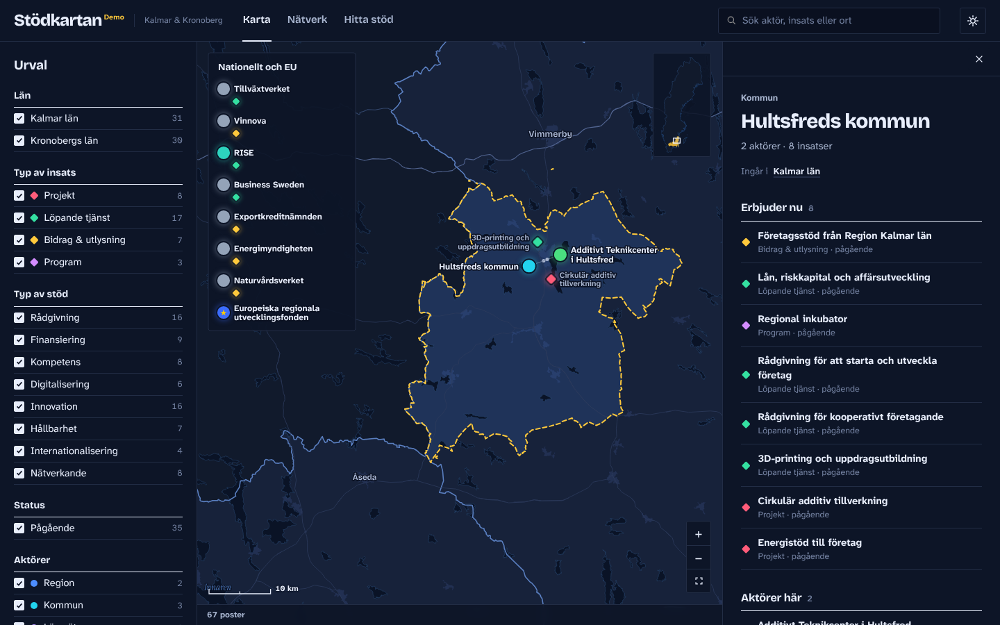
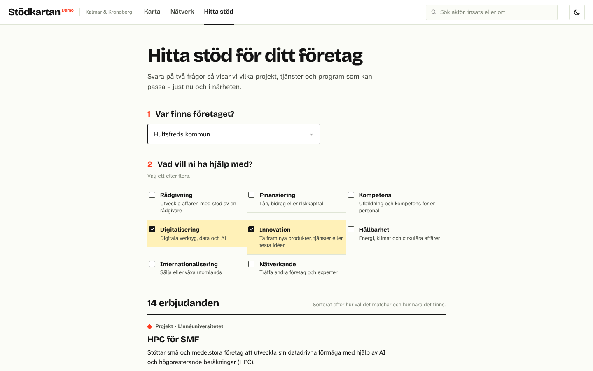

# Stödkartan – resource visualizer

An interactive map of support for small and medium-sized enterprises (SMEs) in
Kalmar and Kronobergs län. It shows which organisations offer support, where
they are, what they offer right now (projects, services, grants and
programmes), and how they are connected through funding, partnerships and
ownership. Companies can use the "Hitta stöd" page to find offers that match
their needs where they are.

The tool itself is in Swedish; code and documentation are in English.

**Site (once published):** https://michaeldaun.github.io/resource_visualizer/


| Hultsfreds kommun in the dark mode | Hitta stöd |
| --- | --- |
|  |  |

## Features

- **Map** of both counties on a detailed basemap: coastline, lakes, borders,
  towns and major roads. Actors sit at their address and initiatives cluster
  around the actor that leads them. National actors and EU funds are shown in
  a box beside the map.
- **Places**: click a municipality, or search for one (or for Öland), to zoom
  in and see which actors are there and what they offer now.
- **Network** view of the same data as a relationship graph.
- **Hitta stöd**: a company picks its municipality and what it needs help with
  and gets a ranked list of offers, with links to the map and the provider.
- **Filters** by county, initiative kind, support type, status and actor type.
  The filter panel doubles as the map legend.
- **Search** across names, descriptions and places.
- **Shareable links**: the URL keeps the view and selection, e.g. `#/karta/dika`,
  `#/karta/plats/oland` or `#/hitta`.
- **Light and dark** modes (Midsommar and Natt) that follow the system setting,
  with a toggle in the header.

## Editing the data

All content is in [`/data`](data) as YAML files that can be edited directly on
GitHub. See [docs/DATA.md](docs/DATA.md) for every field and allowed value. Each
change is validated automatically.

The data is **demo content** gathered from public sources (mainly Region Kalmar
län, Region Kronoberg, Växjö kommun and the organisations' websites). Entries
marked `example: true` have details that are guessed or not yet checked.

## Development

Requires Node.js 22.12 or later.

```sh
npm install
npm run dev        # local dev server at http://localhost:5173
npm run check      # typecheck + validate data + unit tests
npm run test:e2e   # browser tests (Playwright)
npm run build      # production build in dist/
```

### Project structure

```
data/                 YAML content (actors, initiatives, relations)
public/geo/           Basemaps (TopoJSON), generated by the scripts below
scripts/              Data validation and basemap builders
src/data/             Data model, validation and graph building
src/geo.ts            Counties, municipalities and places
src/finder.ts         Matching offers to a company's needs and location
src/views/            Map, network and finder views (D3 and plain DOM)
src/ui/               Sidebar, search and details sheet
src/i18n/sv.ts        All user-facing text
src/theme.ts          Light and dark themes: colours, fonts, line styles
tests/unit/           Vitest unit tests
tests/e2e/            Playwright browser tests
```

### Basemaps

The map is drawn with D3 from basemaps in the repository, so it needs no map
tile service at runtime. There are two files:

- `public/geo/sweden.topo.json` (`npm run geo`): simplified borders for all of
  Sweden and Natural Earth coastlines and lakes. Loaded first.
- `public/geo/detail.topo.json` (`npm run geo:detail -- <cache-dir>`): detailed
  coastline, lakes, borders, roads, municipalities and towns for the two
  counties. Loaded in the background and swapped in.

## Deployment

Pull requests and pushes to `main` run the checks in
[`.github/workflows/ci.yml`](.github/workflows/ci.yml). Publishing to GitHub
Pages is manual for now: run the workflow from the **Actions** tab on `main`. To
deploy automatically on every push to `main`, add the repository variable
`DEPLOY_ON_PUSH` with the value `true` (Settings → Secrets and variables → Actions).

One-time setup: in the repository settings, under **Pages**, set **Source** to
**GitHub Actions**.

## Data sources and credits

- Coastline, lakes, borders and roads in the detailed basemap: © OpenStreetMap
  contributors ([ODbL](https://www.openstreetmap.org/copyright)), via
  [OpenFreeMap](https://openfreemap.org/) vector tiles (OpenMapTiles schema) and
  [Nominatim](https://nominatim.org/).
- Urban areas (tätorter 2023): [SCB](https://www.scb.se/) (CC0).
- Simplified county and municipality borders:
  [okfse/sweden-geojson](https://github.com/okfse/sweden-geojson), based on data
  from Valmyndigheten.
- Coastlines and lakes outside the two counties:
  [Natural Earth](https://www.naturalearthdata.com/) 1:10m (public domain).
- Fonts: Bricolage Grotesque, Atkinson Hyperlegible Next and Instrument Serif
  via Fontsource (SIL Open Font License).

## License

Code: [MIT](LICENSE). Map data keeps the licences listed above.
