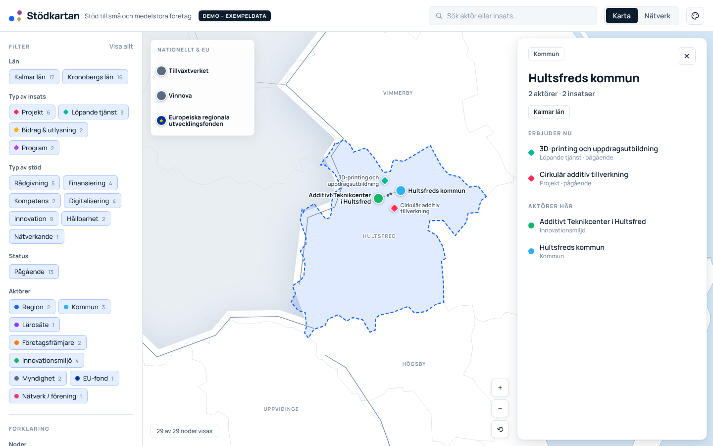

# Stödkartan – resource visualizer

An interactive map of support for small and medium-sized enterprises (SMEs).
It shows which organisations offer support, where they are, which projects and
services they run, and how they are connected through funding, partnerships and
sister projects.

The tool itself is in Swedish; code and documentation are in English.

**Site (once published):** https://michaeldaun.github.io/resource_visualizer/



## Features

- **Map view** of Kalmar län and surroundings. Actors sit at their location and
  initiatives cluster around the actor that leads them. National and EU actors are
  shown in a separate box beside the map.
- **Network view** with the same data as a relationship graph.
- **Details panel** for each node, with clickable relations.
- **Filters** by support type, status, initiative kind and actor type.
- **Search** across names, descriptions and places.
- **Shareable links**: the URL keeps the view and selection, e.g. `#/karta/dika`.

## Editing the data

All content is in [`/data`](data) as YAML files that can be edited directly on
GitHub. See [docs/DATA.md](docs/DATA.md) for every field and allowed value. Each
change is validated automatically.

The current data is **demo content**: the actors are real organisations, but
projects marked `example: true` are invented or incomplete.

## Development

Requires Node.js 22.12 or later.

```sh
npm install
npm run dev        # local dev server at http://localhost:5173
npm run check      # typecheck + validate data + unit tests
npm run test:e2e   # browser tests (Playwright)
npm run build      # production build in dist/
```

### Project structure

```
data/                 YAML content (actors, initiatives, relations)
public/geo/           Basemap (TopoJSON), generated by scripts/build-geo.ts
src/data/             Data model, validation and graph building
src/views/            Map view and network view (D3)
src/ui/               Sidebar, search and details panel
src/i18n/sv.ts        All user-facing text
src/theme.ts          Colours and line styles
tests/unit/           Vitest unit tests
tests/e2e/            Playwright browser tests
```

The map is drawn with D3 from a self-hosted basemap, so it needs no map tile
service or API key.

## Deployment

Pull requests and pushes to `main` run the checks in
[`.github/workflows/ci.yml`](.github/workflows/ci.yml). Publishing to GitHub
Pages is manual for now: run the workflow from the **Actions** tab on `main`. To
deploy automatically on every push to `main`, add the repository variable
`DEPLOY_ON_PUSH` with the value `true` (Settings → Secrets and variables → Actions).

One-time setup: in the repository settings, under **Pages**, set **Source** to
**GitHub Actions**.

## Data sources

County and municipality borders come from
[okfse/sweden-geojson](https://github.com/okfse/sweden-geojson), which is based on
data from Valmyndigheten. Run `npm run geo` to regenerate the basemap.
